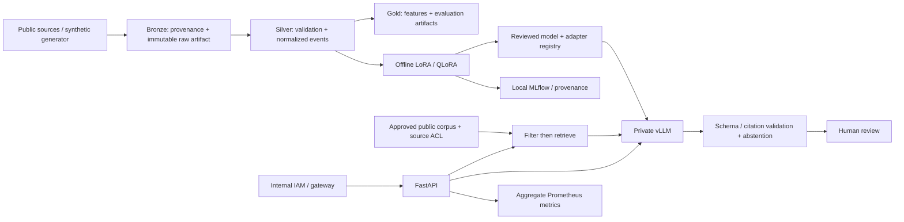

# Architecture

PortShield is a reusable decision-support product within a shared-platform design. This independent
public reference uses fictional events and approved public summaries. It does not connect to institutional systems.

## Implemented boundary

The filesystem stands in for Bronze/Silver/Gold. Pydantic and JSON Schema define Gold event contracts.
Training is an offline single-GPU pipeline. Serving uses a separate local vLLM environment.
The lexical RAG corpus is reviewed, hashed and loaded at startup. Optional generation selects exact quotes
with verified citations; this limits unsupported text at the cost of expressive summaries. Source ACLs
are checked before ranking. Shared caches/embeddings are not implemented.

API JWT authentication uses operator-configured internal JWKS, fixed RS256, issuer, audience, expiry and
Keycloak realm role. It does not delegate identity to model output or request-supplied roles. The API has
no execution tools. Local demonstration review in the older `portshield` CLI is explicitly unauthenticated.

## Target shared platform

PostgreSQL/PostGIS for mastered entities, object storage/Iceberg for history, Airflow/dbt for approved
ingestion, MLflow for registry/lineage, Prometheus/Grafana and Keycloak for service operation.
These are architectural integration boundaries, not bundled production services. Add pgvector or an
offline embedding index only when lexical retrieval failure analysis justifies it. Do not introduce
Kafka/Spark solely for appearance; measure data rate first.

SLM tasks: extraction, taxonomy, abstention and constrained explanation. Time-series models and graph
algorithms own forecasts and scenarios; numeric outputs carry horizon, units, dataset version and
uncertainty. A generated explanation cannot authorize a public-sector or operational decision.

## Resource and failure budgets

Input text max 6,000 characters; questions 2,000; generation 256 tokens; context 2,048 tokens in vLLM;
client timeout 60s; public corpus import max 20,000 characters per reviewed chunk. GPU utilization
0.8 is a research default, not a validated capacity allocation. Gateway body/concurrency/rate limits,
backpressure, TLS and organization-specific SLOs are promotion gates. Upstream failures return 503;
invalid generated event JSON becomes an explicit abstention rather than repaired evidence.
