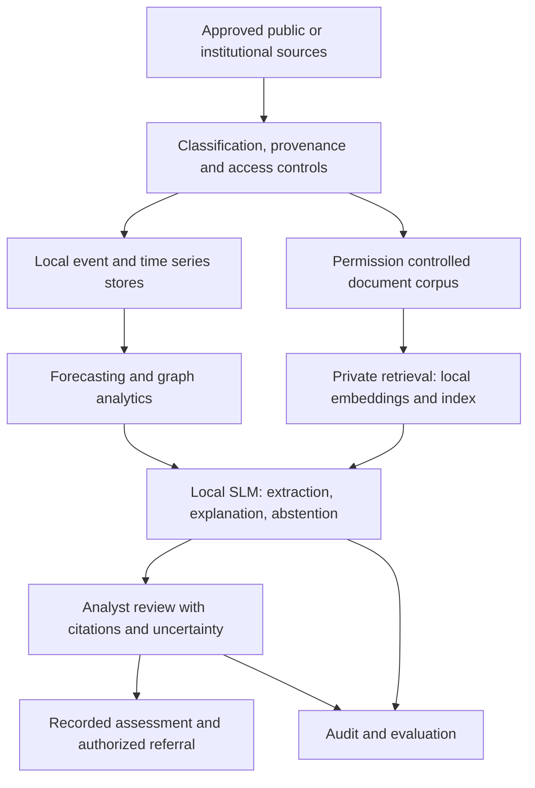

# Architecture and engineering decisions

## Target architecture

The intended institutional boundary is the MPOR data center: training, serving, documents, embeddings, weights, adapters, telemetry, and audit records remain local. Software candidates include PyTorch and LoRA/QLoRA adaptation, compatible local inference serving, PostgreSQL/pgvector, an API service, model experiment tracking, and institutional IAM. Selection requires current license, hardware, security, and Portuguese task benchmarks. No candidate is presented as approved or integrated in this prototype.

## Decisions

1. **Separate language and quantitative reasoning.** Forecast and graph components produce numbers and assumptions. The SLM may explain their outputs but cannot replace their calculations.
2. **Adapt behavior, retrieve knowledge.** Fine-tuning teaches structured extraction, taxonomy, terminology, refusal, and evidence handling. Mutable facts and restricted information stay outside weights.
3. **Filter before retrieval.** Authorization applies before ranking and prompt construction. Recheck source access when opening citations. Cache keys must include identity, entitlements, and document version.
4. **Require human review.** Assessments and referrals require verified analyst identity and recorded evidence. No model output directly triggers an operational command.
5. **Start with transparent baselines.** This repository uses lexical retrieval, rule classification, a trailing-mean forecast, and unweighted connectivity. Their limitations provide a measurable reference for more capable components.

## Proposed fine-tuning process

Build a versioned public/synthetic dataset with event text, source citations, structured labels, information gaps, and abstention examples. Split by scenario, facility placeholder, and time before generating variants to prevent train/test leakage. Review labels; remove secrets and personal information; track dataset provenance. Evaluate base SLM, base SLM plus private RAG, fine-tuned SLM, and integrated fine-tuned SLM plus RAG and analytics on the same held-out tasks.

Prefer the smallest model meeting acceptance criteria. Tune adapters using approved local hardware, track configuration and dataset hashes, and preserve rollback to the previous validated model. No trained adapter, training run, or model benchmark is supplied in this repository.
